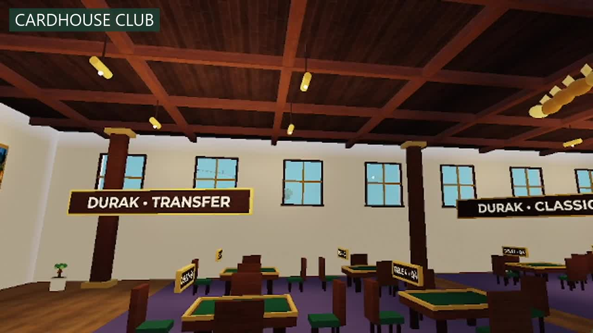
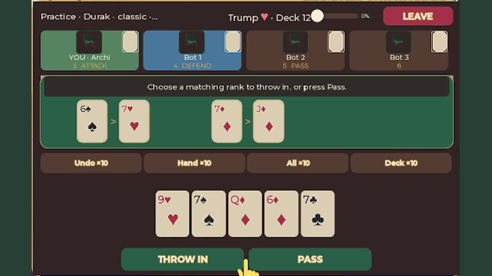
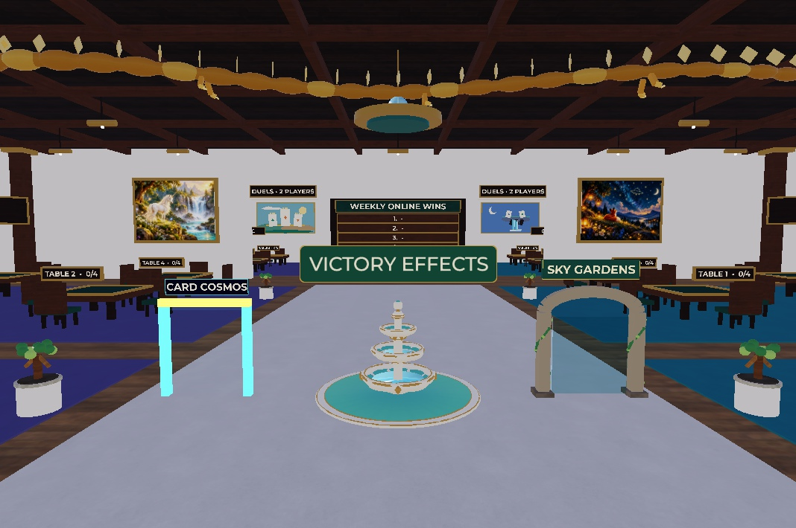
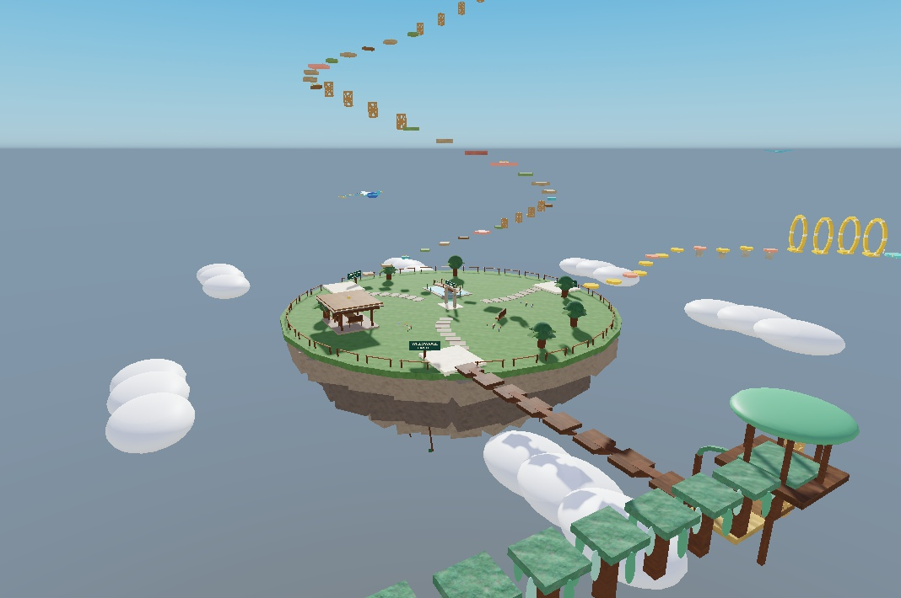
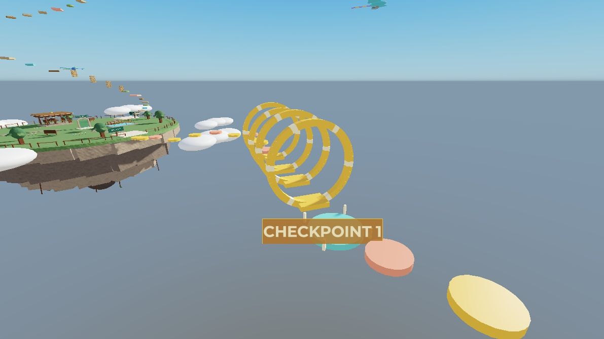
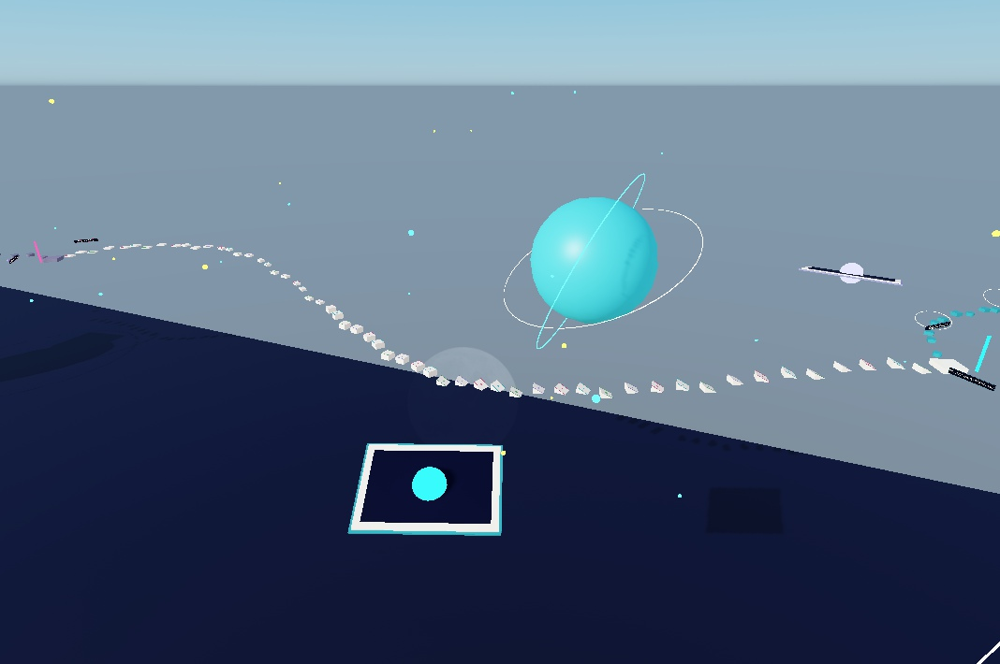
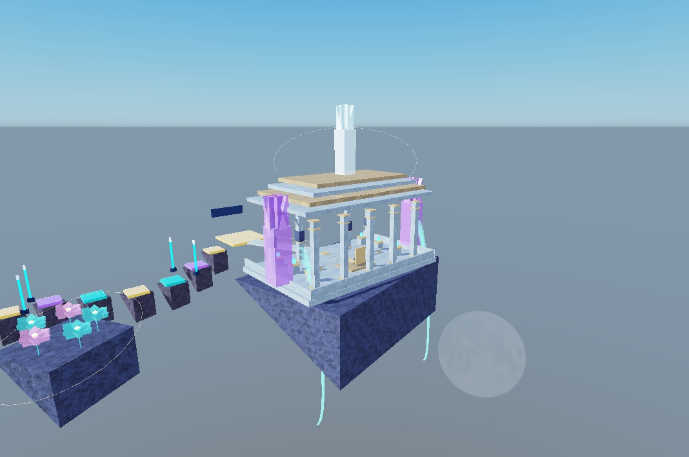

# Cardhouse Club · Клуб Картхауз

**Card games, a cozy club, and parkour above the clouds.**

[Play on Roblox](https://www.roblox.com/games/88375245233005/Cardhouse-Club)

## English

Meet friends at a card table, practise against bots, or take a break with parkour.

- Classic and Transfer Durak; Goat with 36 or 52 cards.
- Games with other players and practice tables with bots.
- A club to explore, collectible card backs, chairs, and celebration effects.
- Card Cosmos and three sky island routes: Sunlit Path, Willowfall Circuit, and Cloudbloom Ascent.
- Prism Tempest: an optional premium parkour route with moving platforms, light barriers, and a starlight palace.
- Coins earned through play, daily tasks, achievements, and secrets.
- English and Russian interfaces, with layouts for computers, phones, and tablets.

Card games have no entry wagers and no coin penalty for losing. Optional purchases include cosmetics, coins, abilities, and access to the premium parkour route.

## Русский

Собирайтесь с друзьями за карточным столом, тренируйтесь с ботами и отправляйтесь на паркур между партиями.

- Классический и переводной «Дурак», «Козёл» на 36 и 52 карты.
- Партии с игроками и отдельные тренировочные столы с ботами.
- Уютный клуб, коллекция рубашек карт, кресел и эффектов празднования.
- Карточный космос и три трассы небесного острова: «Солнечная тропа», «Ивовый круг» и «Облачный подъём».
- Дополнительная платная трасса «Призматическая буря»: движущиеся платформы, световые барьеры и звёздный дворец.
- Монеты за игру, ежедневные задания, достижения и секреты.
- Русский и английский интерфейсы, управление на ПК, телефонах и планшетах.

В карточных партиях нет вступительных ставок и штрафа монетами за поражение. Дополнительные покупки: косметика, монеты, способности и доступ к платному паркуру.

## Video & screenshots · Видео и скриншоты

Real footage and screenshots from the game. / Настоящие кадры игры.

[Watch / download the trailer · Смотреть / скачать ролик](media/cardhouse-club-trailer.mp4) — 45 seconds, 720p, silent. / 45 секунд, 720p, без звука.

| Card games · Карты | Club · Клуб |
| --- | --- |
|  |  |

| Sky island · Небесный остров | Sunlit Path · Солнечная тропа |
| --- | --- |
|  |  |

| Card Cosmos · Карточный космос | Prism Tempest · Призматическая буря |
| --- | --- |
|  |  |

## Updates · Обновления

See [CHANGELOG.md](CHANGELOG.md) for player-facing updates.

Report a bug or suggest an idea in [Issues](https://github.com/01egendarY/cardhouse-club-game/issues).

Сообщить об ошибке или предложить идею можно в [Issues](https://github.com/01egendarY/cardhouse-club-game/issues). Для ошибок укажите устройство, язык игры, действия перед ошибкой и приложите скриншот, если возможно. Не публикуйте личные данные.

This repository presents the game. Game source code and place files are not distributed here.

Roblox is a trademark of Roblox Corporation. This is an independent game project.
