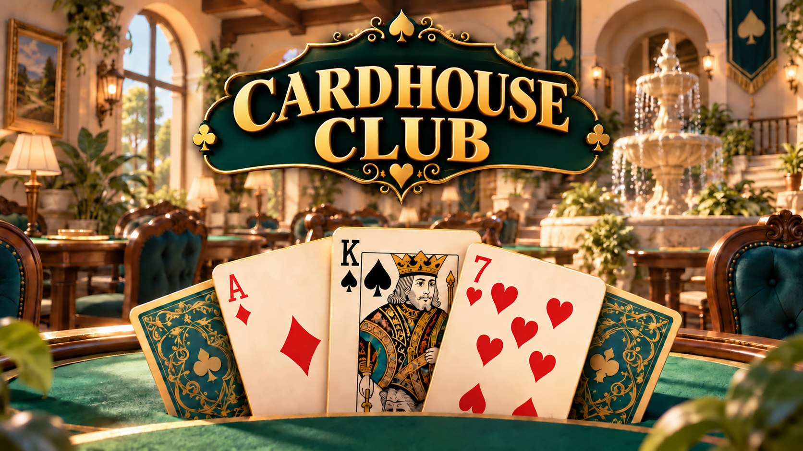
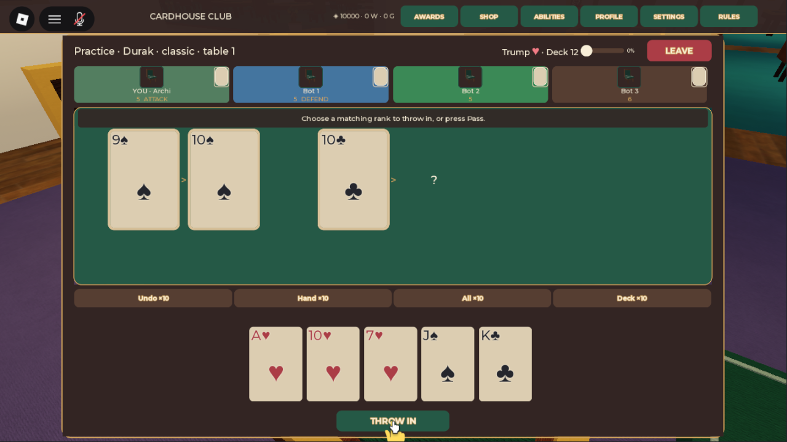
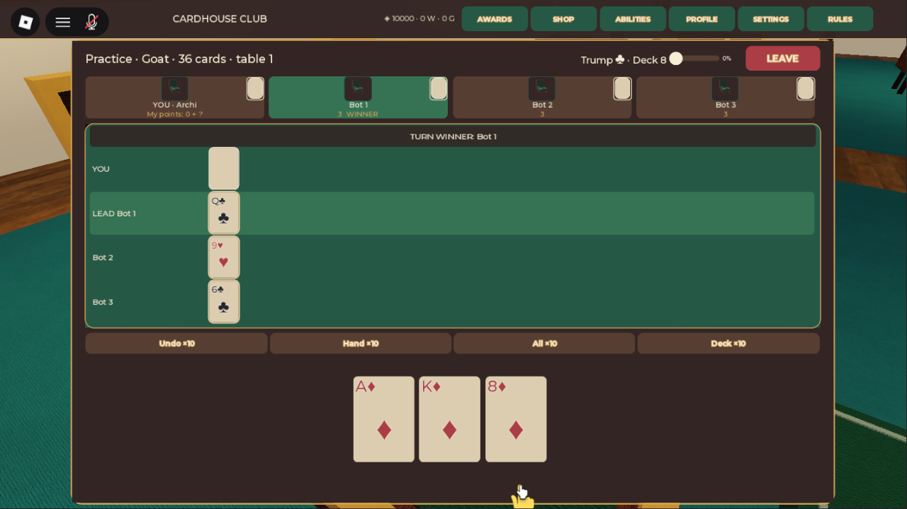
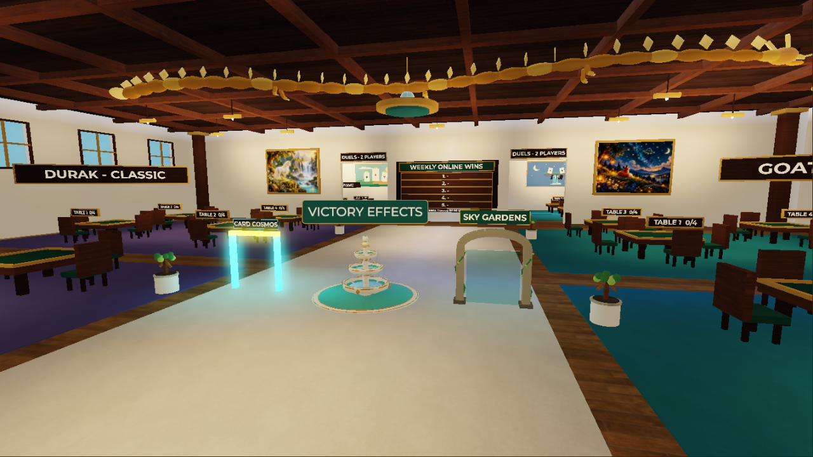
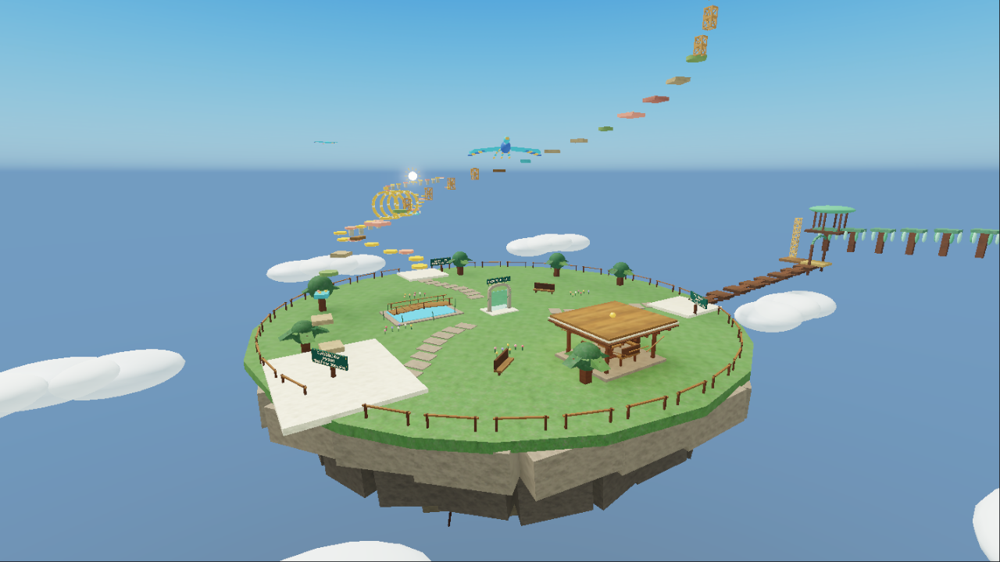
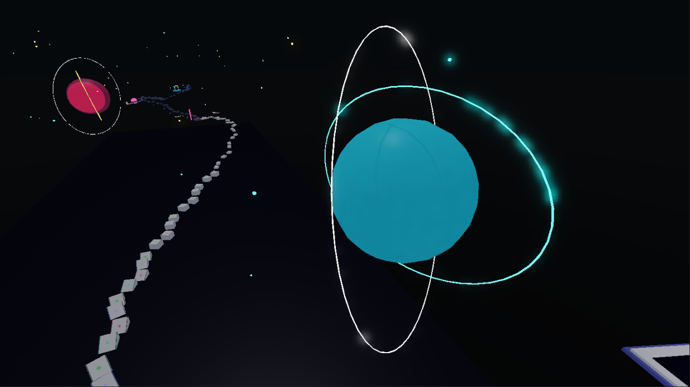
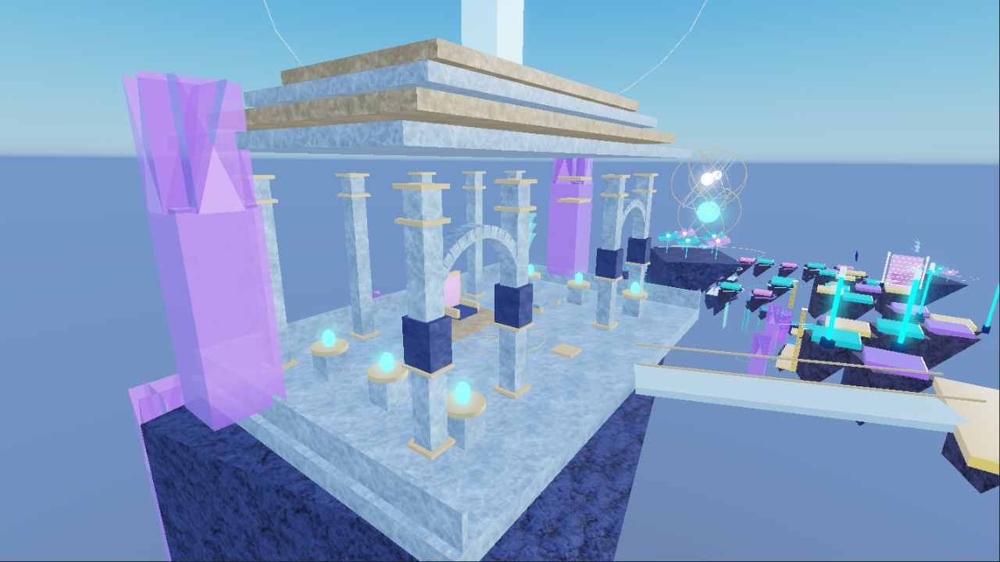

# Cardhouse Club · Клуб Картхауз

**Версия 1.0 · Карточные игры, уютный клуб и паркур над облаками.**

[Играть в Roblox](https://www.roblox.com/games/88375245233005/Cardhouse-Club) · [Версия 1.0](https://github.com/01egendarY/cardhouse-club-game/releases/tag/v1.0) · [Все обновления](https://github.com/01egendarY/cardhouse-club-game/releases) · [English](README.md)

Собирайтесь с друзьями за карточным столом, тренируйтесь с ботами и отправляйтесь на паркур между партиями.

- Классический и переводной «Дурак», «Козёл» на 36 и 52 карты.
- Партии с игроками, дуэли и тренировочные столы с ботами.
- Коллекция рубашек карт, кресел и эффектов празднования.
- Карточный космос и трассы небесного острова: «Солнечная тропа», «Ивовый круг» и «Облачный подъём».
- Платная «Призматическая буря»: движущиеся платформы, световые барьеры и дворец для прогулок.
- Монеты за игру, ежедневные задания, достижения и секреты.
- Интерфейсы на русском и английском для ПК, телефонов и планшетов.

Нужны аккаунт и клиент Roblox. Игра запускается через Roblox; установщик и редактируемая карта здесь не распространяются.

В карточных партиях нет вступительных ставок и штрафа монетами за поражение. Дополнительные покупки: косметика, монеты, способности и доступ к платному паркуру. Добровольный выход из незавершённой партии ограничивает участие в карточных играх на три минуты. Если игрок должен ходить, после 30 секунд бездействия появляется предупреждение, после 60 секунд он покидает партию.

## Видео

Реальные ходы и пролёты, записанные в Studio Play. 48 секунд, 720p, с музыкой.

https://github.com/user-attachments/assets/27bf36b7-583b-4d8a-a276-af33a1c07d0c

[Скачать трейлер в качестве 720p60](https://github.com/01egendarY/cardhouse-club-game/releases/download/v1.0/cardhouse-club-master.mp4)

## Скриншоты

| Дурак | Козёл |
| --- | --- |
|  |  |

| Клуб | Небесный остров |
| --- | --- |
|  |  |

| Карточный космос | Призматическая буря |
| --- | --- |
|  |  |

## Обновления и обратная связь

[История изменений](CHANGELOG.md) · [Релизы](https://github.com/01egendarY/cardhouse-club-game/releases) · [Сообщить об ошибке или предложить идею](https://github.com/01egendarY/cardhouse-club-game/issues)

Для ошибок укажите устройство, язык игры и действия перед ошибкой. Прикладывайте скриншоты без личных данных.

Исходники и редактируемая карта игры здесь не распространяются. Roblox — товарный знак Roblox Corporation. Это независимый игровой проект.
